  

  <h1>AJAY TILAK V</h1>
  <h3>AI / ML ENGINEER · FULL-STACK DEVELOPER</h3>

  

  
  

---

## MISSION BRIEF

I'm **Ajay Tilak V**, an AI/ML-focused developer interested in building practical intelligent applications. I work across machine learning, LLM-powered workflows, backend systems, and modern web interfaces.

- **Current orbit:** LLMs, retrieval-augmented generation (RAG), Edge AI, and deep learning
- **Building:** AI-powered applications and end-to-end software projects
- **Interested in:** Applied AI, privacy-aware systems, automation, and developer tools

## CURRENT OBJECTIVE

Build useful, dependable software by combining intelligent models with thoughtful engineering. I enjoy taking a problem from its first idea through architecture, implementation, and documentation.

## PROJECT CONSTELLATION

<table>
  <tr>
    <td width="50%" valign="top">
      <h3><a href="https://github.com/ajaytilak341/VetraIQ">VetraIQ</a></h3>
      AI-powered industrial product intelligence. Converts catalogs and datasheets into structured, validated product records with confidence scores, source traceability, and human review.
        <b>Stack:</b> Python, FastAPI, React, TypeScript, Tailwind CSS, Ollama
    </td>
    <td width="50%" valign="top">
      <h3><a href="https://github.com/ajaytilak341/CURIO-AI">Curio-AI</a></h3>
      An active-learning platform where students teach concepts to an AI student, receive adaptive questions, and track understanding through feedback and reports.
        <b>Stack:</b> Python, FastAPI, React, JavaScript, Ollama
    </td>
  </tr>
  <tr>
    <td width="50%" valign="top">
      <h3><a href="https://github.com/ajaytilak341/MEDVAULT_ANALYTICS">MedVault Analytics</a></h3>
      A privacy-preserving medical analytics concept using encryption, differential privacy, and an auditable hash-chain ledger.
        <b>Stack:</b> Python, Streamlit, Pandas, NumPy, Cryptography
    </td>
    <td width="50%" valign="top">
      <h3><a href="https://github.com/ajaytilak341/Scuba_SIH">SCUBA SIH</a></h3>
      An edge-oriented voice-activation project exploring a custom wake word and efficient deployment on constrained devices.
        <b>Focus:</b> Edge AI, embedded ML, voice activation
    </td>
  </tr>
  <tr>
    <td width="50%" valign="top">
      <h3><a href="https://github.com/ajaytilak341/ZERO-TRUST-SECURITY">Voice-First Secure Banking</a></h3>
      A voice-driven banking assistant concept for elderly users, combining accessible interaction with task-scoped security and fraud prevention.
    </td>
    <td width="50%" valign="top">
      <h3><a href="https://github.com/ajaytilak341/AGRI-TECH-PROJECT">Tamil Nadu Smart Farmer AI</a></h3>
      Crop-disease diagnosis and multilingual farming advice, combining computer vision with a generative-AI advisory interface.
    </td>
  </tr>
</table>

## TECHNOLOGY DECK

  

**AI / Data:** Machine Learning, Deep Learning, RAG, FAISS, Hugging Face, Ollama, scikit-learn, Pandas, NumPy  
**Backend & APIs:** FastAPI, Flask, REST APIs, SQLAlchemy  
**Frontend:** React, Next.js, TypeScript, Tailwind CSS  
**Tools:** Git, GitHub, VS Code, Docker

## MISSION TELEMETRY

  
  

  

  

## TRANSMISSION CHANNELS

  

### BUILD · EXPLORE · ITERATE

*End of transmission — see you beyond the horizon.*

